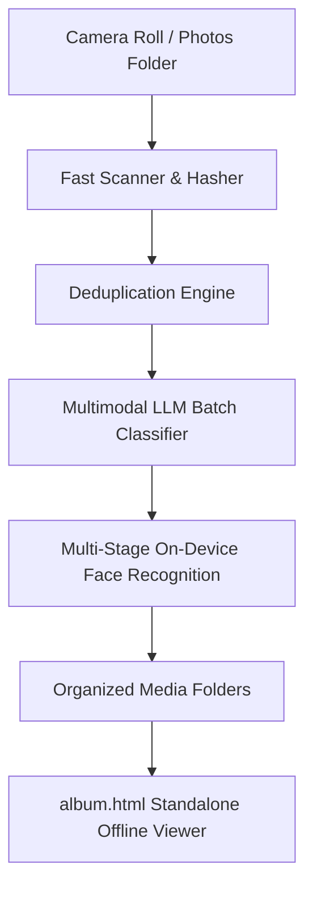

# AI Photo Sorter

An open-source, privacy-first desktop application that scans, deduplicates, categorizes, and organizes large camera rolls and video archives directly on your machine.

---

## 🌟 What Makes This Repo Unique

Unlike standard command-line scripts or simple photo organizers, **AI Photo Sorter** features two industry-first capabilities built specifically for privacy-focused local media management:

### 1. 📴 Zero-Dependency Standalone Offline Album (`album.html`)
> **No local server, no node runtime, no database, no internet required.**
- Generates a single, self-contained `album.html` file right inside your sorted directory.
- **Double-click to open** in Safari, Chrome, Edge, or Firefox at any time—even years later or from an external hard drive/flash drive.
- **Ultra-Fast 60 FPS Gallery**: Smooth virtualized scrolling with embedded low-res thumbnail previews for tens of thousands of items.
- **Built-in 4K Video Player**: Seamless inline playback with scrubbing.
- **1-Click System Trash**: Safely delete unwanted photos directly from the viewer into your native macOS Trash / Windows Recycle Bin.
- **Integrated Offline People Explorer**: Filter your entire gallery by detected individuals with zero active backend.

### 2. 🧠 Multi-Stage On-Device Face Recognition & Clustering
> **Industry-grade biometric clustering running 100% locally with zero cloud face data sharing.**
- **Solves the "Split Identity" Problem**: Most open-source face recognizers fragment the same person across 20+ separate albums due to changes in lighting, angles, facial hair, or age.
- **Two-Stage Complete Profile Unification**: Employs OpenCV YuNet (320x320 face detection) + SFace (128-dimensional biometric embeddings) coupled with multi-pass centroid distance and cross-feature similarity to unify an individual's diverse appearances into one canonical profile.
- **Auto-Sharpening Avatar Selection**: Automatically identifies each person's sharpest, highest-contrast portrait as their album avatar.
- **Dedicated Person Explorer**: One click on "People & Faces" surfaces every recurring family member and friend with photo counts and gallery drill-down.

---

## Key Features

- **100% On-Device & Private**: Your original media files are never altered, moved, or deleted from their source location.
- **Multimodal AI Categorization (Any LLM API Key)**: Fast batch classification powered by your preferred vision provider (Gemini, OpenAI, Anthropic) or local heuristics into intuitive albums: *People & Family, Travel, Food & Drinks, Everyday Clips, Documents, Selfies, and more*.
- **Duplicate Detection**: Identifies byte-identical files, re-saved screenshots, and rapid burst shots into a dedicated review folder.
- **Instant System Trash**: Deleting an unwanted photo or video immediately moves it to your native macOS Trash or Windows Recycle Bin with full "Put Back" capability.

---

## Quick Start

### 1. Clone the Repository
```bash
git clone https://github.com/dch2238/ai-photo-sorter.git
cd ai-photo-sorter
```

### 2. Setup Dependencies & Face Models
```bash
./setup.sh
```
*(Creates an isolated Python virtual environment in `.venv/`, installs dependencies, and downloads lightweight, local face recognition models).*

### 3. Launch Dashboard
```bash
./start.sh
```
Or double-click `Open Photo Sorter.command` on macOS. The dashboard opens automatically at `http://127.0.0.1:8765`.

---

## Configuration

### Any LLM API Key
Bring your own LLM provider. Simply add your API key to a `.env` file in the project root:

```bash
# Add your preferred LLM API key (e.g. Gemini, OpenAI, Claude/Anthropic)
GEMINI_API_KEY="your-api-key-here"
# or
OPENAI_API_KEY="your-api-key-here"
# or
ANTHROPIC_API_KEY="your-api-key-here"
```

The sorter automatically detects your available key and executes high-speed batch classification. If you prefer running without an API key, local vision heuristics or Claude CLI plan integration are supported.

---

## How It Works



1. **Scan & Hash**: Reads metadata, dimensions, and generates perceptual fingerprints without touching originals.
2. **Deduplication**: Separates exact copies, burst shots, and screenshot duplicates into a `_Review` folder.
3. **AI Categorization**: Sorts items in parallel batches with deep multimodal understanding.
4. **Biometric Face Clustering**: Detects faces, computes 128-dim vectors, and consolidates recurring identities.
5. **Standalone HTML Album**: Packages everything into an interactive, zero-dependency offline web album (`album.html`).

---

## License

MIT
